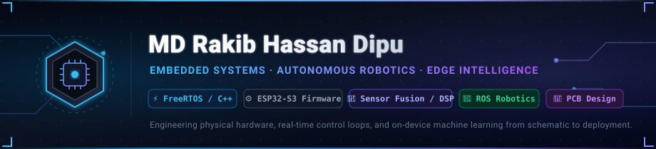

<!-- ══════════════════════════════════════════════════════════════ -->
<!--                     HEADER BANNER                             -->
<!-- ══════════════════════════════════════════════════════════════ -->
<div align="center">
  <a href="https://github.com/rakibdipu">
    
  </a>
</div>

<!-- Typing animation -->
<p align="center">
  
</p>

<!-- Social & Portfolio links -->
<p align="center">
  <a href="https://rakibdipu.github.io"></a>
  &nbsp;
  <a href="https://linkedin.com/in/rakibhassandipu"></a>
  &nbsp;
  <a href="mailto:rakibdipu007@gmail.com"></a>
  &nbsp;
  <a href="https://ieeexplore.ieee.org/document/11502258"></a>
  &nbsp;
  <a href="https://codeforces.com/profile/Hard_lolly"></a>
</p>

<!-- Status & Identity Badges -->
<p align="center">
  
  
  
  
  
</p>

<br/>

---

## 🙋‍♂️ Engineering Profile & Philosophy

> *"I bridge physical silicon and neural algorithms — engineering deterministic embedded firmware, physical sensor-fusion pipelines, and lightweight edge intelligence that solve mission-critical real-world problems."*

I am an **IoT & Robotics Engineering student** at the University of Frontier Technology, Bangladesh (UFTB). My research and engineering work spans **real-time deterministic firmware (FreeRTOS)**, **RF-based Channel State Information (CSI) sensing**, **structural digital twins with on-chip FFT DSP**, **autonomous mobile robotics (ROS)**, and **telehealth edge intelligence**.

- 🔭 **Current Engineering** → Hardware-in-the-loop sensor integration, edge vibration FFT DSP on ESP32-S3, and device-free RF human presence tracking.
- 🔬 **Research Core** → Real-Time Operating Systems (RTOS), Embedded Machine Learning, Digital Twin Synchronizations, and Low-Power Bio-telemetry.
- 📑 **Peer-Reviewed Publications** → First-author paper published at **IEEE RAAICON 2025**; accepted book chapter at **Taylor & Francis / ECCT 2026**.
- 🏆 **Recent Recognition** → Finalist at **ImpactX 2026** (SmartSpiro); 1st Runner-Up at **Hult Prize Campus 2025**.

---

## 🚀 Flagship Engineering Projects

### 🛰️ 1. Edge Sensing & Digital Twin Systems

<div align="center">
  <a href="https://github.com/rakibdipu/Bridge-SHM-DigitalTwin-Structural-Health-Monitoring">
    
  </a>
  <a href="https://github.com/rakibdipu/WiFi-CSI-Indoor-Localization-System">
    
  </a>
</div>

* **Bridge Structural Health Monitoring (SHM):** Low-cost IoT structural monitoring with ESP32-S3 + MPU9250 MEMS. Performs real-time **1024-point on-chip FFT** vibration spectrum analysis, predictive micro-crack alerting, and renders an interactive 3D digital twin dashboard.
* **Wi-Fi CSI Indoor Localization:** 100% privacy-preserving human localization using ESP32-S3 56-subcarrier OFDM RF sensing. Features Hampel & Butterworth filtering, Doppler feature extraction, Random Forest classification, and 2D Kalman Filter state estimation.

---

### ⚡ 2. Safety-Critical RTOS & Bio-Telemetry Devices

<div align="center">
  <a href="https://github.com/rakibdipu/RTOS-Railway-Level-Crossing-Safety-System">
    
  </a>
  <a href="https://github.com/rakibdipu/SmartSpiro-IoT-Spirometer">
    
  </a>
</div>

* **RTOS Railway Level Crossing Platform:** Deterministic FreeRTOS implementation across dual-core ESP32-S3 with 6 prioritized concurrent tasks. Eliminates race conditions with atomic queues and enforces fail-safe state machine (FSM) gate control with dual-sensor obstacle validation *(Accepted at ECCT 2026 / Taylor & Francis)*.
* **SmartSpiro IoT Spirometer:** Award-winning (*ImpactX 2026 Finalist*) clinical screening spirometer utilizing differential pressure sensing and edge machine learning for early respiratory pattern classification (FVC, FEV1, PEF).

---

### 🤖 3. Autonomous Robotics & Applied AI

<div align="center">
  <a href="https://github.com/rakibdipu/AgroBot-Autonomous-Agricultural-Robotics">
    
  </a>
  <a href="https://github.com/rakibdipu/YouTube-Video-Summarizer">
    
  </a>
</div>

* **AgroBot Autonomous Rover:** Field-deployable agricultural robotics combining **ROS `move_base` autonomous row navigation** with an ESP32 differential drive controller, RS485 7-in-1 NPK soil telemetry, and precision spot irrigation.
* **Multimodal AI Video Summarizer:** High-performance video intelligence system utilizing Faster-Whisper (CTranslate2 int8) for 4-5× accelerated speech-to-text, BART abstractive summarization, and cross-platform native execution.

---

## 📚 Academic Publications & Peer-Reviewed Research

<div align="left">

### 1. [IEEE Xplore] Panic Attack Detection for Autism Spectrum Disorder (ASD)
```
📄 Lightweight IoT-Driven Panic Attack Detection and Caregiver Alert System for Autism Spectrum Disorder
```
| Field | Specification |
|:--|:--|
| **Authors** | **MD Rakib Hassan Dipu** (First Author), et al. |
| **Conference** | IEEE 4th International Conference on Robotics, Automation, AI & IoT (RAAICON 2025) |
| **Publisher** | **IEEE** · Indexed on [IEEE Xplore (Document #11502258)](https://ieeexplore.ieee.org/document/11502258) |
| **Architecture** | ESP32-CAM optical flow + MAX30102 HRV + Grove GSR + on-device ML + Dual-channel GSM/MQTT alert |

<details>
<summary><b>📑 Click to expand BibTeX Citation</b></summary>

```bibtex
@inproceedings{dipu2025panic,
  author    = {Dipu, MD Rakib Hassan and others},
  title     = {Lightweight IoT-Driven Panic Attack Detection and Caregiver Alert System for Autism Spectrum Disorder},
  booktitle = {2025 IEEE 4th International Conference on Robotics, Automation, Artificial Intelligence, and Internet-of-Things (RAAICON)},
  year      = {2025},
  address   = {Dhaka, Bangladesh},
  publisher = {IEEE},
  url       = {https://ieeexplore.ieee.org/document/11502258}
}
```
</details>

<br/>

### 2. [Taylor & Francis Books] RTOS-Based Railway Level Crossing Safety System
```
📄 RTOS-Based Intelligent Railway Level Crossing System Using ESP32-S3
```
| Field | Specification |
|:--|:--|
| **Authors** | **MD Rakib Hassan Dipu** (First Author), Saurav Chandra Das |
| **Conference** | International Conference on Electrical, Computer and Communication Technology (ECCT 2026) |
| **Publisher** | **Taylor & Francis Books** |
| **Status** | ✅ Accepted for Publication · Selected for Oral Presentation |
| **Architecture** | Dual-core ESP32-S3 + FreeRTOS 6-task priority queue + Deterministic FSM + Redundant ultrasonic/IR |

<details>
<summary><b>📑 Click to expand BibTeX Citation</b></summary>

```bibtex
@article{dipu2026railway,
  author    = {Dipu, MD Rakib Hassan and Das, Saurav Chandra},
  title     = {RTOS-Based Intelligent Railway Level Crossing System Using ESP32-S3},
  journal   = {Taylor & Francis Books / ECCT 2026},
  year      = {2026}
}
```
</details>

</div>

---

## 🛠️ Technical Competencies & Toolchain

<table>
  <tr>
    <td width="50%" valign="top">
      <h4>⚡ Firmware & Embedded Systems</h4>
      <ul>
        <li><b>Languages:</b> C, C++ (OOP 2.0, STL), Python, Embedded C</li>
        <li><b>MCUs & SOCs:</b> ESP32-S3 (Dual-Core, Octal PSRAM), ESP32-CAM, ESP8266, STM32 basics, Arduino</li>
        <li><b>RTOS & Concurrency:</b> FreeRTOS (Task Priority, Queues, Mutex, Event Groups, Semaphores)</li>
        <li><b>Embedded Architecture:</b> Deterministic FSMs, ISR Callbacks, Watchdogs, Power Sleep Modes</li>
      </ul>
    </td>
    <td width="50%" valign="top">
      <h4>📡 Protocols & Hardware Interfacing</h4>
      <ul>
        <li><b>Buses:</b> I2C, SPI, UART, RS-485 Modbus, ADC/DAC, PWM</li>
        <li><b>Wireless & Telemetry:</b> Wi-Fi CSI (PHY-layer OFDM), BLE, MQTT, WebSockets, HTTP REST</li>
        <li><b>Cellular & Sensors:</b> SIM800L GSM/GPRS, MAX30102 PPG, MPU9250 MEMS, HC-SR04, PMS5003</li>
      </ul>
    </td>
  </tr>
  <tr>
    <td width="50%" valign="top">
      <h4>🧠 Edge AI, DSP & Machine Learning</h4>
      <ul>
        <li><b>Frameworks:</b> PyTorch, TensorFlow, Scikit-Learn, OpenCV</li>
        <li><b>Signal Processing:</b> 1024-Point on-chip FFT, Hampel Filtering, Butterworth Bandpass, 2D Kalman Filter</li>
        <li><b>Edge Models:</b> Decision Trees, Random Forest, SVM (quantized for MCU fixed-point inference), CTranslate2 int8</li>
      </ul>
    </td>
    <td width="50%" valign="top">
      <h4>🤖 Robotics, EDA & Engineering Tools</h4>
      <ul>
        <li><b>Robotics:</b> ROS (Noetic/ROS 2), <code>move_base</code>, SLAM, Differential Drive PID, Kinematics</li>
        <li><b>EDA & CAD:</b> EasyEDA, Altium Designer (Schematics & PCB Layout), SolidWorks</li>
        <li><b>Software Tools:</b> Linux (Ubuntu 24/26), Git, CMake, Docker, FastAPI, SQLite3, Cisco Packet Tracer</li>
      </ul>
    </td>
  </tr>
</table>

---

## 🏆 Verified Honors & Leadership

| Honor / Role | Organization / Venue | Scope & Impact |
|:---|:---|:---|
| 🏅 **Finalist — ImpactX 2026** | ImpactX Global Innovation | *SmartSpiro*: Cost-effective IoT respiratory diagnostic device |
| 🥈 **1st Runner-Up** | Hult Prize Campus Competition 2025 | Sustainable Tech Venture addressing UN SDGs |
| 📝 **First-Author IEEE Paper** | IEEE RAAICON 2025 (MIST) | Published & presented autism health-monitoring edge architecture |
| 📖 **Taylor & Francis Paper** | ECCT 2026 Oral Presentation | Selected research on deterministic FreeRTOS safety systems |
| ☁️ **Google Cloud Scholarship** | Google Cloud / Wadhwani Foundation | Merit scholarship for Cloud Architecture & Computing |
| 🩸 **President / Org. Secretary** | BADHAN (Voluntary Blood Donors' Org) | Led student life-saving voluntary blood transfusion drives at UFTB Unit |
| 🤖 **Deputy Organizing Secretary** | UFTB Robotics Club | Coordinated *ROBOFUSION 1.0*, workshops, and hardware hackathons |
| 🌐 **Joint General Secretary** | National Children's Task Force (NCTF) | Governed youth rights advocacy across Bangladesh (40,000+ member network) |

---

## 📊 GitHub Analytics & Code Activity

<div align="center">
  
  
</div>

---

## 🤝 Let's Connect & Collaborate

<p align="center">
  <a href="https://rakibdipu.github.io">
    
  </a>
  &nbsp;
  <a href="https://linkedin.com/in/rakibhassandipu">
    
  </a>
  &nbsp;
  <a href="mailto:rakibdipu007@gmail.com">
    
  </a>
  &nbsp;
  <a href="https://github.com/rakibdipu?tab=repositories">
    
  </a>
</p>

<div align="center">
  
  <br/>
  <sub><i>⚡ "The best engineers don't just write code — they engineer physical solutions that matter." ⚡</i></sub>
</div>
